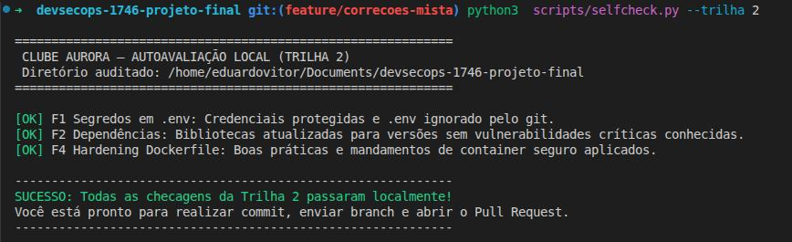
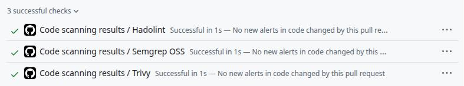

# Relatório de Evidências Técnicas - Clube Aurora

**Nome do Aluno(a):** Eduardo Vitor Vieira Torres
**Turma:** DevSecOps 1746  
**Trilha Escolhida:** Trilha 2 (Mista) 
**Link do Repositório / Fork no GitHub:** https://github.com/eduardovitor/devsecops-1746-projeto-final 
**Link do Pull Request Principal:** https://github.com/eduardovitor/devsecops-1746-projeto-final/pull/1

---

## 1. Evidência do Pipeline Inicial (Antes das Correções)

## 2. Resumo das Correções Implementadas

Descreva brevemente como você corrigiu cada achado sob seu escopo técnico:

| Achado | Arquivo Modificado | Resumo da Alteração Realizada |
|---|---|---|
| **F1: Segredos** | `.gitignore` / `.env` | Desindexação do .env do cache de arquivos para push, atualização do gitignore e  criação do .env.example|
| **F2: SCA** | `requirements.txt` | Pesquisa sobre as versões mais recentes das libs, atualização das versões diretamente no arquivo|
| **F3: SAST** *(Trilha 3)* | `app/db.py` | |
| **F4: Hardening** | `Dockerfile` | Aplicação dos princípios de hardenização de segurança no código da imagem da aplicação Docker |
| **F5: DAST** *(Trilha 3)* | `app/main.py` e `app/__init__.py` | |
| **F6: Menor Privilégio** *(Trilha 3)* | `app/db.py` / `app/main.py` | |
| **F7: IaC** *(Trilha 3)* | `docker-compose.yml` | |

---

## 3. Evidência do Pipeline Final (Após as Correções)

---

## 4. (Opcional - Trilha 3) Justificativa de Aceitação de Risco (`.trivyignore`)

